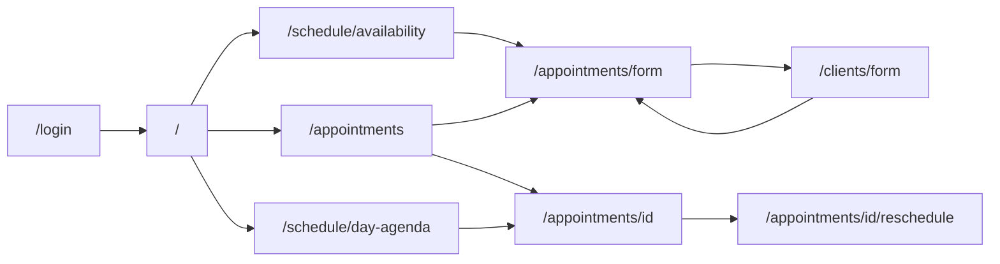

# Navigation map of the Hidalgo Junior admin panel

Routes are browser paths (no hash). TanStack Router matches them from `src/routes/`. The generated
tree is `src/app/routeTree.gen.ts`. Signed-in screens declare `staticData.screen`, which the shell
header reads (`src/features/shell/model/header.ts`). An invalid search value is dropped; the screen
opens as if the parameter were missing.

## Navigation model

| Operation                  | What happens                                                                 | Used for                                |
| -------------------------- | ---------------------------------------------------------------------------- | --------------------------------------- |
| Sidebar section            | Replaces the location with that section                                      | The eleven sections                     |
| Link to a detail or a form | Pushes a history entry                                                       | Opening a record or a form              |
| Save of a create           | Replaces the form with the new detail                                        | Services, staff, clients, blocks, rules |
| Save of an edit            | Goes back to the detail that opened the form                                 | The same forms                          |
| Legacy alias               | Replaces the location with the list (recurring aliases open `tab=recurring`) | Old Flutter paths                       |
| Browser back and forward   | The router follows the history entry                                         | Every screen                            |

Filters, search, page, tab, and the selected day live in the URL. There is no in-memory page stack.

## Routes

### Public routes

| Route        | Screen        | Search                                                                                                    |
| ------------ | ------------- | --------------------------------------------------------------------------------------------------------- |
| `/login`     | `LoginScreen` | `redirect`: path opened after sign-in. An absolute URL, a protocol-relative URL, and `/login` are ignored |
| `/auth-gate` | none          | Redirects to `/`. The route guard restores the session; this path has no screen of its own                |
| `/_kit`      | kit page      | Development build only. The production build has no such route. `mode` is `light` or `dark`               |

### Sidebar sections

In sidebar order (`SIDEBAR_SECTIONS` in `src/features/shell/model/sections.ts`):

| Route                     | Screen                | Search parameters                                                                                                                                                                                                                                                                                       |
| ------------------------- | --------------------- | ------------------------------------------------------------------------------------------------------------------------------------------------------------------------------------------------------------------------------------------------------------------------------------------------------- |
| `/`                       | Dashboard             | —                                                                                                                                                                                                                                                                                                       |
| `/schedule/availability`  | Availability overview | `serviceId`, `day` (`YYYY-MM-DD`). The screen pins the first public service and the default bookable day once they resolve                                                                                                                                                                              |
| `/appointments`           | Appointments list     | `search`, `status` (`pending`, `confirmed`, `completed`, `cancelled`, `no_show`), `date` (`today`, `tomorrow`, `thisWeek`, `thisMonth`), `from`, `to`, `page` (from 2). With no date parameter the list opens on today                                                                                  |
| `/schedule/day-agenda`    | Day agenda            | `day`, `scope` (`day` or `week`), `view`, `search`, `serviceId`, `appointments`, `blocked`. Under 900 px of content width the layout is the day timeline even when `scope` is `week`                                                                                                                    |
| `/schedule/slot-watches`  | Slot-watch demand     | `date` (sent to the backend; missing means open watches from today on), `service`, `status` (`active` or `held`), `search`, `page`. Service, status, and search run on the loaded list                                                                                                                  |
| `/schedule/blocked-slots` | Blocked slots         | `tab` (`punctual` or `recurring`). Punctual: `search`, `date` (`today`, `next7Days`, `month`, `nextMonth`), `from`, `to`, `type` (`fullDay` or `range`), `page`. Recurring: `weekday` (1–7), `status` (`all` or `inactive`; missing means active), `page`. Switching tabs drops the other tab's filters |
| `/schedule/working-hours` | Working hours         | —                                                                                                                                                                                                                                                                                                       |
| `/services`               | Services list         | `search`, `status` (`active` or `inactive`), `category`, `page`. A category wins over a status in a hand-written URL                                                                                                                                                                                    |
| `/clients`                | Clients list          | `search`, `status` (the seven customer filters except `all`), `date` (`today` or `month`), `from`, `to`, `page`                                                                                                                                                                                         |
| `/admins`                 | Staff list            | `search`, `status` (`active` or `inactive`), `date` (`today` or `month`), `from`, `to`, `page`                                                                                                                                                                                                          |
| `/business`               | Business content      | `tab` (`info`, `booking`, `notifications`, `legal`, `web`, `gallery`). Missing `tab` is `info` and the URL omits it. `doc` is the selected legal or web code and is kept only on those two tabs                                                                                                         |

Every signed-in route may also carry `sidebar`, one of the section paths. It chooses the highlighted
section. Without it, the highlight follows the path prefix (`activeSectionFor`).

### Detail and form routes

| Route                                         | Screen                                                                 | Search                                                                                                                                                                                        |
| --------------------------------------------- | ---------------------------------------------------------------------- | --------------------------------------------------------------------------------------------------------------------------------------------------------------------------------------------- |
| `/appointments/{id}`                          | Appointment detail and customer push                                   | —                                                                                                                                                                                             |
| `/appointments/{id}/reschedule`               | Reschedule                                                             | —                                                                                                                                                                                             |
| `/appointments/form`                          | Create an appointment                                                  | `clientId`, `clientLabel`, `backLabel`, `lockInitialUser=true`, `prefillServiceId`, `prefillDate`, `prefillTime`                                                                              |
| `/clients/{id}`                               | Client detail, including that client's appointments                    | `backLabel` when opened from an appointment                                                                                                                                                   |
| `/clients/form`                               | Create a client                                                        | `backLabel`. From the appointment form: `returnTo=appointmentForm` and that form's prefill. After save the form is replaced by the appointment form with the new `clientId` and `clientLabel` |
| `/clients/{id}/form`                          | Edit a client                                                          | —                                                                                                                                                                                             |
| `/admins/{id}`                                | Staff detail, including that account's appointments when it also books | —                                                                                                                                                                                             |
| `/admins/form`                                | Create a staff account                                                 | —                                                                                                                                                                                             |
| `/admins/{id}/form`                           | Edit a staff account                                                   | —                                                                                                                                                                                             |
| `/services/{id}`                              | Service detail                                                         | —                                                                                                                                                                                             |
| `/services/form`                              | Create a service                                                       | —                                                                                                                                                                                             |
| `/services/{id}/form`                         | New version of a service                                               | —                                                                                                                                                                                             |
| `/schedule/blocked-slots/form`                | Create a one-off block                                                 | —                                                                                                                                                                                             |
| `/schedule/blocked-slots/{id}`                | One-off block detail                                                   | —                                                                                                                                                                                             |
| `/schedule/blocked-slots/{id}/form`           | Edit a one-off block                                                   | —                                                                                                                                                                                             |
| `/schedule/recurring-blocked-slots/form`      | Create a recurring rule                                                | —                                                                                                                                                                                             |
| `/schedule/recurring-blocked-slots/{id}`      | Recurring rule detail                                                  | —                                                                                                                                                                                             |
| `/schedule/recurring-blocked-slots/{id}/form` | Edit a recurring rule                                                  | —                                                                                                                                                                                             |

A date range in the URL wins over a preset. A range that ends before it starts is treated as no
filter, except the appointments list, which still defaults to today when nothing valid is set.

### Legacy and fallback routes

These paths are registered and render nothing of their own. Each one redirects, replacing the
history entry:

| Route                                      | Result                                  |
| ------------------------------------------ | --------------------------------------- |
| `/appointments/detail`                     | `/appointments`                         |
| `/appointments/reschedule`                 | `/appointments`                         |
| `/services/detail`                         | `/services`                             |
| `/clients/detail`                          | `/clients`                              |
| `/admins/detail`                           | `/admins`                               |
| `/schedule/blocked-slots/detail`           | `/schedule/blocked-slots`               |
| `/schedule/recurring-blocked-slots`        | `/schedule/blocked-slots?tab=recurring` |
| `/schedule/recurring-blocked-slots/detail` | `/schedule/blocked-slots?tab=recurring` |

An unknown path under a session shows the not-found screen inside the shell, with a link to `/`.
Without a session it goes to `/login` first.

## Guards

The signed-in layout is `src/routes/_authed.tsx`.

| Situation                                      | Result                                                                                       |
| ---------------------------------------------- | -------------------------------------------------------------------------------------------- |
| Any signed-in path, no usable session          | `/login?redirect=<requested path>`                                                           |
| `/login` or `/auth-gate` with a usable session | `/`                                                                                          |
| Session expiry                                 | `/login`, then the expiry notice once                                                        |
| Sign-out                                       | `/login`. Back does not reopen the panel                                                     |
| Role check                                     | `canAccessAdmin`, on sign-in and on restore. See the [card](./overview.md#actors-and-access) |

There is no second session check on each navigation. The backend rejects a call the role cannot
make. A 401 refreshes once; a rejected refresh or a blocked user expires the session.

## Live notices

The signed-in shell shows a bell (`ActivityBell` in `src/features/activity`). From 768px it
floats at the top right of the page content, outside the sidebar. The mobile header keeps it on
the right. It is not a
route and it does not change the highlighted section. The list is the 100 newest announced
notices, newest first. The count is how many of them this administrator has not read. Above 9 the
badge reads 9+. Opening the list marks nothing. A timed notice says whether that time is
today, tomorrow, or another day. Each row shows the
kind's icon and puts that kind's word in bold, in the success, warning, or danger color. A read
notice stays in place and is shown in muted text. Marking
one row, the selection, or every row writes that choice and leaves the row in the list. A row that has a place marks that event
and navigates with the router, so a form with unsaved changes asks before leaving. A toast uses
the same navigation and does not mark the event. On a wide window it sits at the bottom right of
the content, about 360px wide. Events from a reconnect do not toast. The stream and the read
calls are in the
[backend API consumption reference](./contracts/backend-api.md#live-activity).

## Responsive layout

`shellLayoutFor` (`src/features/shell/model/layout.ts`):

| Width        | Layout                                                                                                                                                                                  |
| ------------ | --------------------------------------------------------------------------------------------------------------------------------------------------------------------------------------- |
| under 768 px | Drawer and the mobile header. The header is the only `banner`                                                                                                                           |
| 768–1023 px  | 60 px icon rail. A control opens the labeled sidebar as an overlay and closes it on navigation. The rail does not push the page, and the desktop collapse preference does not change it |
| from 1024 px | 240 px sidebar. Staff can collapse it. The choice is kept (`hj_admin.sidebar_collapsed`) and survives a reload. Collapsed is the 60 px rail                                             |

Lists that have a card layout use it under 900 px of content width.

## Screen graph

