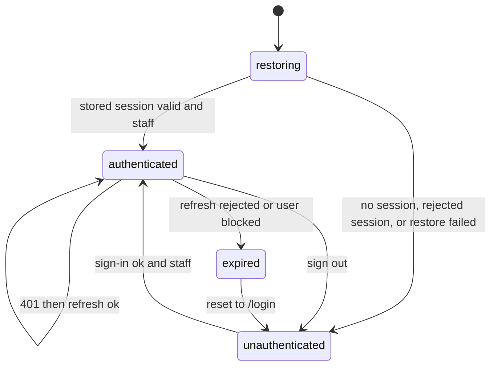

# Hidalgo Junior admin panel

## What it does

The admin panel (`jordi_hidalgo_admin`) is the web panel salon staff use to run the Hidalgo Junior
salon. It shows the day's figures and agenda, and lets staff manage appointments, opening hours and
blocked time, customers, staff accounts, the service catalog, customer slot watches, and the business
content shown in the customer app and on the public website. It is a React single-page app
([ADR-003](/engineering/adrs/admin-panel-react-spa)), built with Vite and served as static files. It
holds no domain data of its own: every read and write goes to the `jordi_hidalgo_backend` REST API
through a client generated from that API's OpenAPI contract.

It replaced the Flutter panel on 2026-10-13. `https://admin.hidalgojunior.com` serves this panel.
Staging is `https://shy-rain-a1f2.jhidalgojunior.workers.dev`, built against the staging API.
Both are published with `make deploy-staging` and `make deploy-prod` (Wrangler CLI).
Paths stay the same, so bookmarks keep working. Storage keys changed, so staff signed in once at
cutover. The Flutter source was removed from the app repository. Rollback is the previous Cloudflare
Pages deployment, if it was kept; that deployment cannot be rebuilt from git.

The backend owns the domain. Appointment, customer, service, schedule, slot-watch, and content
entities, their statuses and transitions, and their business rules are documented on the
[backend card](/engineering/services/hidalgo-backend). This card documents only what the panel itself
owns (ADR-002).

Related documents: [navigation map](./navigation.md), [flows](./flows/index.md),
[backend API consumption](./contracts/backend-api.md), [operations](./operations.md),
[coverage matrix](./coverage-matrix.md).

## Responsibilities

### Actors and access

| Actor                                    | Access                                                                                                                      |
| ---------------------------------------- | --------------------------------------------------------------------------------------------------------------------------- |
| Staff with role `admin` or `super_admin` | The whole panel. `canAccessAdmin` (`src/features/auth/model/staff-member.ts`) runs after sign-in and after session restore. |
| Any other signed-in user (a customer)    | Signed out at once, with the "no admin access" message on sign-in and with no notice on restore.                            |
| Visitor without a session                | The login screen. The requested path is kept and opened after a successful sign-in.                                         |

The panel does not distinguish `admin` from `super_admin` in the UI. The backend knows the roles
`customer` and `admin` and requires `admin` on every `/admin/*` route, so `super_admin` is accepted
here and still fails those calls. There is no skip-login flag.

### Feature modules

Each module lives in `src/features/<module>/`. A feature imports another feature only through its
`index.ts`. `users` serves both staff and clients because both are `/admin/users`.

| Module         | Screens                                                                                 | What staff do there                                                                                                                                                                           |
| -------------- | --------------------------------------------------------------------------------------- | --------------------------------------------------------------------------------------------------------------------------------------------------------------------------------------------- |
| `auth`         | `LoginScreen`, `SessionRestoringScreen`                                                 | Sign in; wait while a stored session is restored.                                                                                                                                             |
| `shell`        | `AppShell`, not-found screen                                                            | Sidebar, drawer, language, theme, sign-out, and the live-notices bell.                                                                                                                        |
| `activity`     | bell in the shell, no route                                                             | The 100 newest announced changes, newest first. The count is the unread ones. A read notice stays in the list. Mark read, and open the related screen. One stream refreshes the open screens. |
| `dashboard`    | `DashboardScreen`                                                                       | Today's appointments, pending appointments, free slots today, customers this week, and the next appointment; jump to common sections.                                                         |
| `availability` | `AvailabilityOverviewScreen`                                                            | Pick a public service and a date, see free and taken slots, start a new appointment from a free slot.                                                                                         |
| `appointments` | list, detail, form, reschedule, day agenda, and the appointments block on a user detail | List and filter appointments; work the day or week agenda; create, reschedule, change status, cancel; bulk actions; send a push message to the customer.                                      |
| `slot-watches` | `SlotWatchesScreen`                                                                     | List open slot watches, filter them, cancel one.                                                                                                                                              |
| `schedule`     | working hours, punctual blocks, recurring rules                                         | Weekly opening hours, one-off blocks, and recurring blocks with per-date exceptions.                                                                                                          |
| `services`     | list, detail, create, new version                                                       | Catalog, order, public-site visibility, activate, deactivate, delete.                                                                                                                         |
| `users`        | staff and client lists, details, and forms                                              | Customer and staff accounts.                                                                                                                                                                  |
| `business`     | one screen, six tabs                                                                    | Business info, booking settings, reminder notifications, legal documents, web pages, and the home gallery.                                                                                    |

### Use cases

A use case is a call the panel makes. The HTTP operation behind each one is listed in the
[backend API consumption reference](./contracts/backend-api.md). Call sites live in
`src/features/*/api` and in `src/shared/api/middleware/session.ts` (refresh).

| Module              | Use case                                                                                                                             | Flow                                                                                                                           |
| ------------------- | ------------------------------------------------------------------------------------------------------------------------------------ | ------------------------------------------------------------------------------------------------------------------------------ |
| auth                | Sign in (`POST /auth/login`), restore (`GET /auth/me`), refresh (`POST /auth/refresh`), sign out (`POST /auth/logout`, best effort)  | [Sign-in and session](./flows/admin-sign-in-and-session.md)                                                                    |
| dashboard           | Load the admin summary                                                                                                               | —                                                                                                                              |
| availability        | Public services, bookable dates, slots for a date                                                                                    | —                                                                                                                              |
| appointments        | List, get, create, reschedule, status, cancel, bulk, customer push and its history, reschedule chain                                 | [Create](./flows/create-appointment.md), [change](./flows/change-appointment-status.md), [push](./flows/send-customer-push.md) |
| slot watches        | List, cancel                                                                                                                         | —                                                                                                                              |
| schedule            | Opening hours and shifts; one-off blocks; recurring rules and exceptions                                                             | [Create a blocked slot](./flows/create-blocked-slot.md)                                                                        |
| services            | List, get, categories, create (also a new version), order, public site, activate, deactivate, delete                                 | —                                                                                                                              |
| customers and staff | List, get, create, update, delete, verify, activation email, password-setup email, phone matches                                     | —                                                                                                                              |
| business            | Info, booking settings, notification settings, legal documents, web pages, gallery slides                                            | [Upload a gallery image](./flows/upload-gallery-image.md)                                                                      |
| activity            | The 100 newest announced events with this administrator's read mark, mark them read, and the live stream that refreshes open screens | —                                                                                                                              |

No call site in `src/features/*/api` is unused. The panel does not call `GET /app/version`; the
footer version is the package version.

### Surfaces

The panel exposes no API. The surfaces it serves are:

- **Browser routes**: every route, guard, and search parameter is in the [navigation map](./navigation.md).
- **Platform integrations**: none. It uses no push registration, camera, location, or analytics.
  Gallery upload uses the browser file picker and a presigned `PUT` that does not carry the panel
  JWT. The only build target is the web.

### Client-side state

Working data lives in TanStack Query. Zustand holds the session tokens and three display
preferences. The session is the only client-owned state machine. Restore runs in the route guard
(`src/routes/_authed.tsx`); while it runs the shell shows `SessionRestoringScreen`.

| From            | To              | Trigger                                                                                               |
| --------------- | --------------- | ----------------------------------------------------------------------------------------------------- |
| restoring       | authenticated   | A stored access token is accepted by `GET /auth/me` and `canAccessAdmin` is true                      |
| restoring       | unauthenticated | No token. Tokens stay when the restore call fails for network or server reasons                       |
| restoring       | unauthenticated | The token is rejected, or the role cannot access the panel: tokens are cleared, with no expiry notice |
| unauthenticated | authenticated   | Sign-in succeeds and the role can access the panel                                                    |
| unauthenticated | unauthenticated | Sign-in fails, or the account is not staff (signed out at once, with a message)                       |
| authenticated   | authenticated   | A 401 triggers one shared refresh; the request is retried once                                        |
| authenticated   | expired         | Refresh is rejected (401/403), or a 403 says the user is blocked or `forbidden` (no longer an admin)  |
| authenticated   | unauthenticated | Staff signs out from the sidebar or the drawer                                                        |
| expired         | unauthenticated | The router goes to `/login` and the login screen shows "your session has expired" once                |

A refresh that fails for network or server reasons keeps the tokens. The sequence is in the
[sign-in and session flow](./flows/admin-sign-in-and-session.md).

Once the shell is up, the panel opens one live stream per tab
(`src/shared/api/activity-stream.ts`). The last event id is `hj_admin.activity_cursor`. Sign-out
and expiry clear it with the tokens. It is where the stream resumes, not which notices are read.
Reads stay on the server. Language, theme, and the collapsed sidebar are unchanged.

### Status presentation

The backend owns these status models and their transitions
([backend status models](/engineering/services/hidalgo-backend)). The panel only maps each value to
a label and a tone, and decides which actions it offers.

**Appointment status** (`src/features/appointments/model/appointment.ts`):

| Value           | Tone                                        | Actions offered                                                                                     |
| --------------- | ------------------------------------------- | --------------------------------------------------------------------------------------------------- |
| `pending`       | warning                                     | change status, cancel, reschedule, bulk select; complete and no-show once the start time has passed |
| `confirmed`     | info                                        | same as `pending`                                                                                   |
| `completed`     | success                                     | correct the status from the detail (see below)                                                      |
| `cancelled`     | danger                                      | correct the status from the detail (see below)                                                      |
| `no_show`       | neutral, strong                             | correct the status from the detail (see below)                                                      |
| `rescheduled`   | muted                                       | none                                                                                                |
| any other value | neutral, strong; the raw value as the label | none of the status actions                                                                          |

`booked` is not folded into `confirmed`. It is shown as an unknown value.

A closed appointment (`completed`, `cancelled`, `no_show`) has no reschedule or cancel button, but its
detail still offers the status change, so staff can correct a mistake: every other status staff can
set, with completed and no-show only once the start has passed (`statusTargetsOf`,
`isCorrectableStatus`). A `rescheduled` revision belongs to a chain and offers none. Setting a
cancelled future appointment back to pending or confirmed can be refused when its slot is taken; the
toast then names the appointment in the way (customer, service, time) or says until when a
waiting customer holds the slot.

**Slot-watch status** (`src/features/slot-watches/model/slot-watch.ts`): `active` and `held` are
open and listed. Staff can filter by either and cancel any open watch. A watch with a linked
appointment is an upgrade and shows that note.

**Customer list filters** (`src/features/users/model/clients-search.ts`): `all`, `active`,
`inactive`, `blocked`, `with_upcoming_appointment`, `without_upcoming_appointment`,
`new_this_month`. Staff can block (reason required), unblock, verify, and delete a customer.
The block dialog says the client cannot sign in, book, or use the connector, and cannot unblock
themselves. The unblock dialog says those three return. New appointment on a blocked client stays
disabled. The block is the account flag the API already enforces. The panel does not add a
connector-only switch.

**Staff account** (`staffStatus` in `src/features/users/model/admin-user.ts`): active is success,
inactive is neutral on the list and danger on the detail, and a blocked account is danger on the
list whatever its active label.

**Service**: active is success, inactive is neutral. Editing a service opens the new-version form;
there is no in-place update.

## Dependencies and Contracts

| Dependency                                               | Direction       | Contract                                                   | Purpose                                                                                   |
| -------------------------------------------------------- | --------------- | ---------------------------------------------------------- | ----------------------------------------------------------------------------------------- |
| [hidalgo-backend](/engineering/services/hidalgo-backend) | panel → backend | [Backend REST API](/engineering/apis/hidalgo-backend-rest) | All data and every action. Detail: [backend API consumption](./contracts/backend-api.md). |
| Object storage (presigned URL from the backend)          | panel → storage | Presigned `PUT` returned by the backend                    | Home-gallery image bytes. The `PUT` does not send the panel JWT.                          |

The card declares `consumes` for the backend REST API and `depends_on` for the backend. It
`implements` the hub capabilities it fronts and `realizes` the hub journeys staff take part in. It
`relates_to` the Flutter panel it replaces. It does not depend on `app_api`, `app_core`,
`app_models`, or `app_ui`.

## Business Invariants

These rules are enforced by the panel. The authoritative domain rules live in the backend.

1. **Staff only.** After sign-in and after session restore, a role other than `admin` or
   `super_admin` is signed out (`canAccessAdmin`).
2. **Business time.** Days, clock times, and "has this appointment started?" use `Europe/Madrid`
   (`src/shared/lib/business-time.ts`), not the browser's zone.
3. **Complete and no-show.** Offered only for an appointment that is not final and whose start time
   has passed in business time, individually and in bulk.
4. **Bulk actions** apply only to `pending` and `confirmed`. They are one request per appointment.
   A partial failure names the appointments that failed.
5. **Cancellation.** Blocking a customer needs a reason. A cancellation from the detail or from a
   list keeps the stored internal notes and sends an empty reason. A bulk cancel asks for a reason
   of at most 500 characters and sends it as the cancellation reason, still keeping the notes.
6. **Customer push** is offered for an appointment linked to a customer account. The body is limited
   to 280 characters (`CUSTOMER_PUSH_MAX_LENGTH`).
7. **Blocked time vs. appointments.** Saving a one-off block lists the `pending` and `confirmed`
   appointments the range covers when the range is new or has changed. Staff can keep them or
   cancel them; the block's reason, at most 500 characters, becomes the cancellation reason, and
   each appointment's stored internal notes are sent back.
8. **Booking window.** The booking-settings form rejects a first bookable day later than the last.
   The future-appointment limit accepts 0 (no cap) and rejects a negative value. Saving always
   sends that number, including 0.
9. **Duplicate phone.** Before saving a customer whose phone can be edited, the panel counts other
   customers with that phone, warns, and lets staff save anyway.
10. **Editing a service creates a new version** (`POST /admin/services`). There is no in-place update.
11. **A full salon day** is detected from the salon clock and stored as 00:00–23:59. The panel does
    not use the backend's `full_day` filter to decide what it shows.
12. **Leaving a form with changes** asks first, through the router and when the tab closes.
13. **An invalid environment refuses to start.** `VITE_API_BASE_URL` must be an `http` or `https` URL.
14. **Live notices.** The bell lists the 100 newest announced events for this administrator, newest
    first. The count is the unread ones. Marking one leaves it in place, shown as read. Opening
    the list does not mark them. A toast does not mark them. Marking one, the selection, or all of
    them is a write. The cursor in local storage is only where the stream resumes.

## Out of scope

- Domain rules, statuses, and transitions of appointments, slot watches, services, and schedules
  (owned by the backend).
- Push delivery: the panel asks the backend to send; the backend talks to FCM.
- Offline use: every action needs the API.
- The customer app, the public website, and the Flutter panel, which are separate components.
- Error reporting. Left out of the first release (ADR-003).
- A tray of notices already read, a sound, an operating-system notification while the tab is
  closed, and push to the salon phone.
- Announcing a change made in this panel or by the salon connector. Those facts refresh the open
  screens and do not enter the bell.
